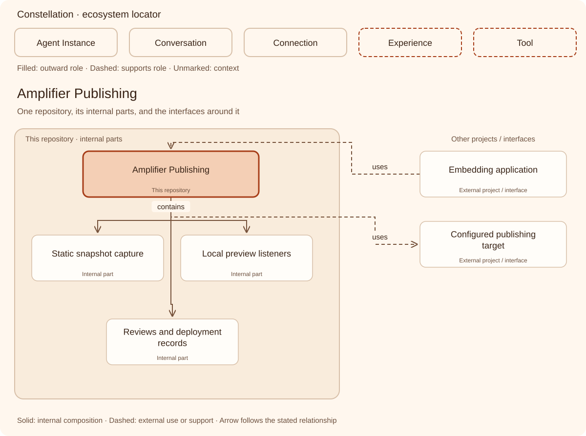

# Amplifier Publishing

A Python library for previewing and publishing sites that have already been
built. It captures immutable static files, serves local previews, and manages
reviewed deployments and rollbacks.

Use it when your application needs publishing controls without handing the
publishing library a build command, model, or workspace runtime.

## Get started

Use Python 3.11 or later on a POSIX system with `flock` and directory-relative
file operations. From a checkout, install the package in a virtual environment:

```sh
uv venv
uv pip install .
```

Build your site separately first. Its output directory must contain `index.html`.
The following example opens a loopback preview of `./dist`:

```python
from amplifier_publishing import Publisher

with Publisher('./.publishing') as publisher:
    release = publisher.build(
        './dist', site_id='example', session_id='demo', request_id='build-1',
    )
    preview = publisher.preview(
        release['id'], session_id='demo', request_id='preview-1',
    )
    print(preview['result']['url'])
    input('Press Enter to close the preview. ')
```

Keep storage separate from the site's source and built output. An embedding app
must authorize the source directory and derive `session_id` from its authenticated
user or session.

## Publish and recover

Review the exact release with `review()` before calling `deploy()`. Updates and
rollbacks use an expected site revision to prevent overwriting someone else's
change. Keep the original request ID when looking up an uncertain outcome;
restarting the process does not resume old listeners or replay publishing work.

Previews bind to loopback. Private-network deployment is available with an
explicit address, but this library supplies neither remote-user authentication
nor TLS. Your application must provide those controls. It does not create public
URLs, DNS records, cloud accounts, or tunnels.

## Reference

- [Publisher API](src/amplifier_publishing/README.md)
- [Service and SSH target configuration](docs/PUBLISHING-TARGET.md)
- [Integration contract](contracts/publishing.v1.md)

For development, install the `dev` dependency group with `uv sync --group dev`
and run `uv run pytest`.


<!-- ecosystem-map:start -->
## Where this fits

A reusable library for immutable site snapshots, local previews and reviewed publishing.

Supports: Tool, Experience.



[Product page](https://microsoft.github.io/amplifier-constellation/projects/amplifier-publishing/) · [Open the map](docs/ecosystem-map.svg) · [Map guide](https://github.com/microsoft/amplifier-constellation/blob/main/docs/ecosystem-maps.md)

<details>
<summary>The five shared building blocks</summary>

[](https://microsoft.github.io/amplifier-constellation/)

</details>

<!-- ecosystem-map:end -->

## Immutable package delivery

The package workflow builds an exact reviewed revision, verifies its wheel and
source archive against Git, and checks the installed package outside the checkout.
Its focused artifact check covers the public read/retention composition and core
local publication, backup and owner boundaries. The full contract runner remains
`scripts/qualify-installed.sh`; package acceptance is not live-host acceptance.

For an accepted commit, the normal manual workflow may publish four original
assets under `publishing-v<version>`: the wheel, source archive,
`publishing-source.json` and `SHA256SUMS`. The receipt binds the full repository
revision/tree and exact package inputs, including the `src/amplifier_publishing`
to `amplifier_publishing` installed mapping. Source acceptance, package publication
and a consumer's explicit selection are separate steps. Historical qualification
and Unified-produced artifacts retain their original source and bytes; 0.1.2
identifies the new compatibility package, not the earlier sealed 0.1.1 wheel.

Publication never moves an existing tag or overwrites an asset. If a command loses
its reply, inspect that exact tag/release ID and original bytes before any manual
continuation. The helper reconciles only matching immutable assets; do not rebuild
a different package under an existing tag. This GitHub package workflow is delivery
automation, separate from the Publisher domain API and its effect receipts.

Do not co-install this distribution with Unified while Unified owns the
`amplifier_publishing` import. Unified must select and assemble a verified package
through its own delivery workflow; publishing here does not alter that selection.

## Contributing

Most contributions require you to agree to a
Contributor License Agreement (CLA) declaring that you have the right to, and actually do, grant us
the rights to use your contribution. For details, visit [Contributor License Agreements](https://cla.opensource.microsoft.com).

When you submit a pull request, a CLA bot will automatically determine whether you need to provide
a CLA and decorate the PR appropriately (e.g., status check, comment). Simply follow the instructions
provided by the bot. You will only need to do this once across all repos using our CLA.

This project has adopted the [Microsoft Open Source Code of Conduct](https://opensource.microsoft.com/codeofconduct/).
For more information see the [Code of Conduct FAQ](https://opensource.microsoft.com/codeofconduct/faq/) or
contact [opencode@microsoft.com](mailto:opencode@microsoft.com) with any additional questions or comments.

## Trademarks

This project may contain trademarks or logos for projects, products, or services. Authorized use of Microsoft
trademarks or logos is subject to and must follow
[Microsoft's Trademark & Brand Guidelines](https://www.microsoft.com/legal/intellectualproperty/trademarks/usage/general).
Use of Microsoft trademarks or logos in modified versions of this project must not cause confusion or imply Microsoft sponsorship.
Any use of third-party trademarks or logos are subject to those third-party's policies.
